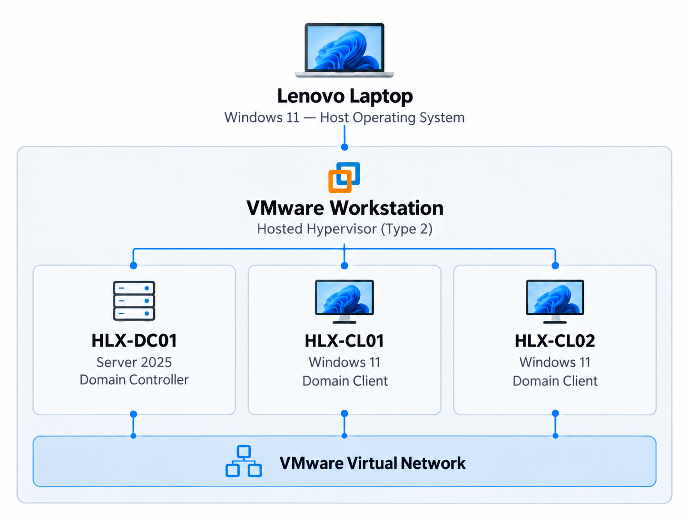
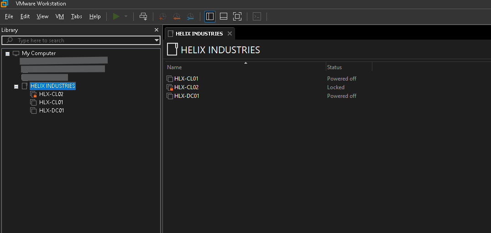
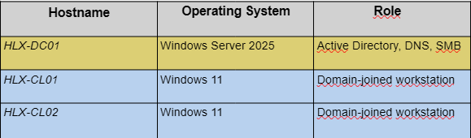
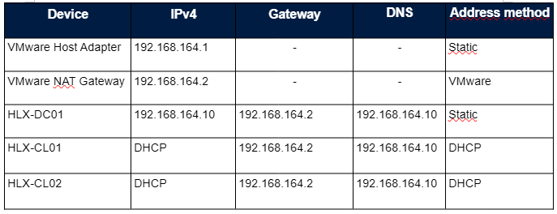

# HELIX INDUSTRIES
### Windows Server & Active Directory Administration Lab

A hands-on Windows Server and Active Directory administration lab built using VMware Workstation Pro, simulating a small enterprise IT environment.

## Overview

This project demonstrates practical skills in Windows Server administration, Active Directory Domain Services (AD DS), DNS, Group Policy, domain authentication, SMB file sharing, and NTFS permissions.

The focus is on understanding technical decisions, deploying and configuring services, validating functionality, troubleshooting issues, and documenting the implementation process.
## Architecture

The lab runs entirely on a Lenovo laptop using Windows 11 as the host operating system and VMware Workstation as a hosted (Type 2) hypervisor.

Three virtual machines simulate a small corporate Windows domain environment, including one Domain Controller and two domain-joined Windows workstations.

The virtual machines communicate through a VMware virtual network, with IP addressing and DNS configured specifically for the lab.

### VMware Infrastructure Overview

The lab was deployed using VMware Workstation Pro and consists of three virtual machines: HLX-DC01 running Windows Server 2025, and HLX-CL01 and HLX-CL02 running Windows 11 Pro.

Both Windows 11 clients have been successfully joined to the `corp.helix.test` Active Directory domain.

## Virtual Machine Inventory

**Active Directory Domain:** `corp.helix.test`

**NetBIOS Domain:** `HELIX`

## IP Addressing
The lab uses VMware Workstation Pro NAT networking (VMnet8), with a dedicated virtual subnet (192.168.164.0/24).

The Domain Controller (HLX-DC01) uses a static IP address, while both Windows 11 clients obtain their IP addresses through DHCP and use the Domain Controller for DNS resolution.

## Project Objectives

- Plan IP addressing and verify network connectivity
- Deploy a Windows Server Domain Controller
- Configure Active Directory Domain Services and DNS
- Create departmental Organizational Units, users and security groups
- Join two Windows 11 clients to the domain
- Configure and validate departmental Group Policies
- Implement SMB file sharing and mapped network drives
- Document configuration, verification and troubleshooting

## Project Status

**Phase 1 — Core Implementation Completed**

### Infrastructure & Networking
- [x] Set up VMware Workstation Pro
- [x] Configure VMware NAT networking (VMnet8)
- [x] Deploy Windows Server 2025 (HLX-DC01)
- [x] Deploy two Windows 11 Pro clients
- [x] Configure static IP addressing and DNS
- [x] Join both Windows 11 clients to corp.helix.test

### Active Directory
- [x] Install and configure AD DS and DNS
- [x] Create Active Directory forest and domain
- [x] Create departmental Organizational Units
- [x] Create domain users and Global Security Groups
- [x] Validate domain user authentication

### Group Policy
- [x] Deploy and validate Engineering wallpaper GPO
- [x] Configure USB storage restrictions for non-IT departments
- [x] Validate USB restrictions on HLX-CL01 (Engineering)
- [x] Validate USB restrictions on HLX-CL02 (Finance)
- [x] Configure and validate Sales mapped drive GPO
- [ ] Test IT Exception
- [ ] Validate USB restrictions on a Sales workstation

### File Services
- [x] Configure SMB file sharing (SalesReports)
- [x] Configure NTFS and share permissions using AGDLP
- [x] Validate authorized Sales user access
- [x] Validate access denied for unauthorized users
- [x] Validate automatic network drive mapping (S:)

### Final Validation & Documentation
- [x] Document Active Directory and domain integration
- [x] Document implemented Group Policies
- [x] Document SMB access and mapped drive functionality
- [x] Complete final GitHub documentation review

### Future Enhancements — Phase 2
- [ ] Install and authorize Windows DHCP Server
- [ ] Configure DHCP scope and options
- [ ] Validate DHCP leases on Windows 11 clients
- [ ] Configure Adobe Acrobat AI restriction GPO
- [ ] Implement backup and recovery procedures
- [ ] Document additional troubleshooting scenarios

**Note:** The core implementation is complete. USB restrictions have been tested on Engineering and Finance workstations. Testing the IT workstation exception and Sales workstation restriction remains future validation work.

## Security and Privacy

This project uses fictitious company identities and lab-only accounts. 
